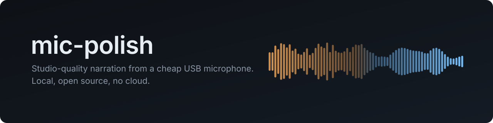
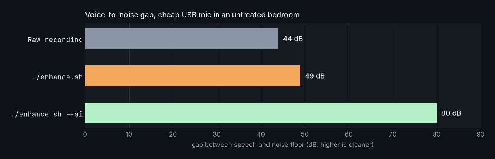
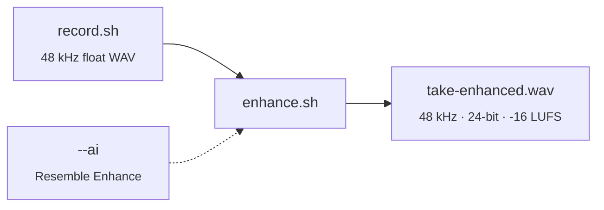
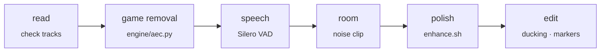
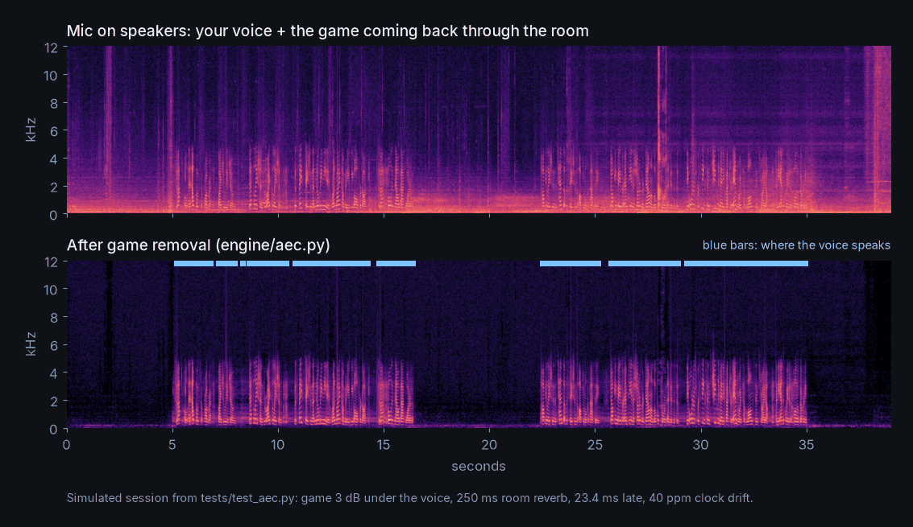

<p align="center">
  
</p>

<p align="center">
  <a href="LICENSE"></a>
  
  
  
  
</p>

<p align="center">
  <a href="#quick-start">Quick start</a> ·
  <a href="#how-it-works">How it works</a> ·
  <a href="#gameplay-sessions">Gameplay sessions</a> ·
  <a href="#usage">Usage</a> ·
  <a href="#configuration">Configuration</a> ·
  <a href="#troubleshooting">Troubleshooting</a>
</p>

---

mic-polish is a local voice pipeline for video essays, gameplay commentary and podcasts. It records
your voice on its own track, removes the room noise, restores the frequencies a budget microphone
loses, and delivers a broadcast-ready file at a consistent loudness.

If you play on **speakers instead of headphones**, it also takes the game out of your mic, using the
game's own audio track as the reference. Nothing is uploaded anywhere. Every step runs on your
machine with FFmpeg and open-source models.

<p align="center">
  
</p>

<sub>Raw recording: cheap USB mic, untreated bedroom. `./enhance.sh`: classic DSP chain with RNNoise. `./enhance.sh --ai`: Resemble Enhance on the GPU, then the same chain. Measured on a 15-second take recorded with an Arcano AM-BLACK-1. The gap is the difference
between the speech level and the noise floor; higher is cleaner.</sub>

## Highlights

<table>
<tr>
<td width="50%" valign="top">

**Two quality levels**<br>
A fast DSP chain that needs only FFmpeg, and an AI mode that rebuilds the voice with
[Resemble Enhance](https://github.com/resemble-ai/resemble-enhance).

</td>
<td width="50%" valign="top">

**Game removal for speaker setups**<br>
Play on speakers and talk over it. The game is subtracted from the mic with offline echo
cancellation that tracks delay and clock drift.

</td>
</tr>
<tr>
<td valign="top">

**Ready for the edit**<br>
Speech detection, the game track ducked under your voice, and the speech segments as CSV and
FilmCraft markers.

</td>
<td valign="top">

**Consistent loudness**<br>
Every output lands at -16 LUFS with peaks under -1.5 dBFS, so narration sits clearly above game
audio.

</td>
</tr>
<tr>
<td valign="top">

**GPU when you have one**<br>
Intel Arc (PyTorch XPU) or NVIDIA (CUDA), with an automatic CPU fallback if the GPU is busy or
times out.

</td>
<td valign="top">

**Transparent and private**<br>
Each stage is one documented line in the FFmpeg filter graph. A before/after report after every
run. No accounts, no cloud, no telemetry.

</td>
</tr>
</table>

## Quick start

```bash
git clone https://github.com/sidnei-almeida/mic-polish.git
cd mic-polish

./setup-mic.sh                      # once: fix the USB mic's hardware gain
./record.sh                         # record a take (stay silent for the first 3 s), Ctrl+C to stop
./enhance.sh takes/take-XXXX.wav    # -> takes/take-XXXX-enhanced.wav
```

For the AI mode and for gameplay sessions, run `./setup.sh` once first (see [Installation](#installation)).

## How it works



`enhance.sh` runs this chain:

| # | Stage | Purpose |
| --- | --- | --- |
| 1 | High-pass 80 Hz | Removes desk thumps, rumble and mains hum |
| 2 | Spectral denoise | Learns the room's steady hiss from the first 3 seconds of silence |
| 3 | RNNoise | Neural speech denoiser for the remaining noise, steady or not |
| 4 | EQ | -3 dB at 300 Hz (boxy sound), +3 dB at 4 kHz (clarity), +2 dB above 10 kHz (air) |
| 5 | De-esser | Tames the sibilance the presence boost brings up |
| 6 | Compressor | Evens out loud and quiet words (3:1 above -21 dB) |
| 7 | Loudness | Measured with EBU R128, then one fixed gain to -16 LUFS |
| 8 | Limiter | Holds the peaks under -1.5 dBFS |

Denoising (stages 2 and 3) is chosen automatically:

- **`--ai`**: Resemble Enhance replaces stages 2 and 3. It removes the noise *and* regenerates the
  voice, restoring the low and high frequencies the microphone cuts off.
- **DeepFilterNet**: used instead of RNNoise when the
  [`deep-filter`](https://github.com/Rikorose/DeepFilterNet) binary is on your `PATH`.
- **RNNoise**: the default, built into FFmpeg, using the bundled `models/sh.rnnn` speech model.

## Gameplay sessions

`session.sh` takes a whole recording, as [GPU Screen Recorder](https://git.dec05eba.com/gpu-screen-recorder/)
writes it (game on audio track 1, mic on track 2), and returns everything the edit needs.

```bash
./session.sh ~/Videos/episode/gameplay.mkv          # outputs in gameplay-polish/ next to it
./session.sh mic.wav --game game.wav                 # or separate files
./session.sh gameplay.mkv --ai --duck-db -10 --json  # options; --json prints progress as JSON lines
```



| Step | What happens |
| --- | --- |
| read | The tracks are loaded and checked: a silent mic, clipping, a mic too quiet. If the mic turns out to be *ahead* of the game, the tracks are swapped, and it says so. |
| game removal | The game is subtracted from the mic (below). Skipped when there is no game track. |
| speech | [Silero VAD](https://github.com/snakers4/silero-vad) finds where you speak. |
| room | The quietest non-speech moments of the whole session become a 3 s clip of the room's noise, put in front of the take, so the denoiser learns the room (not whatever the first 3 s happened to be). |
| polish | `enhance.sh` with the same options (`--ai`, `--warm`, `--pitch`). |
| edit | The game track ducked by 8 dB while you talk (eased in and out, held between close sentences), markers, a report. |

Outputs, all on the recording's timeline:

| File | Contents |
| --- | --- |
| `voice.wav` | The mic, game removed and polished (48 kHz, 24-bit, -16 LUFS) |
| `game-ducked.wav` | The game track lowered under the voice (stereo) |
| `markers.csv` | Speech segments: start, end, duration, timecode |
| `filmcraft.jsonl` | The same as FilmCraft markers: `filmcraft-cli --project p.fcproj --save run filmcraft.jsonl` |
| `duck.json` | The ducking keyframes, for an editor that wants them instead of the rendered track |
| `report.json` | Delay, drift, what was removed, how much you talked |

### How the game is removed

<p align="center">
  
</p>

The recorder captures the game twice: clean on its own track, and again through the room into the
mic. With the clean copy as a reference this is echo cancellation, done offline (`engine/aec.py`):

1. **Delay and clock drift.** The mic hears the speakers a few milliseconds late, and the two devices
   run on slightly different clocks, so the delay creeps over a long session (50 ppm is 0.18 s an
   hour). It is measured with GCC-PHAT across the take, fitted with a robust line, then refined on
   short windows with an upsampled correlation. The game track is resampled onto the mic's timeline
   with a windowed-sinc interpolator.
2. **Room filter, solved rather than adapted.** Per frequency bin, a filter covering ~250 ms of
   reverb is the least-squares solution over 20 s blocks, computed only where the game plays and you
   don't speak, so your voice never teaches it to cancel itself.
3. **Calibrated residual suppression.** What a linear filter cannot model (speaker distortion, the far
   reverb tail) is suppressed by exactly the amount measured to be left over, so the voice keeps its body.

On the simulated session in the figure (`tests/test_aec.py`: game 3 dB under the voice through
250 ms of room reverb, 23.4 ms late, 40 ppm drift):

| Measure | Result |
| --- | --- |
| Delay and drift found | 23.40 ms and 39.99 ppm (exact to 0.01) |
| Game where you don't speak | -26.3 dBFS → -59.0 dBFS (32.8 dB removed) |
| Voice vs everything else | 3.0 dB in the mic → 34.4 dB after |
| Speed | 39 s of audio in 11.4 s on a desktop CPU |

Long sessions run in 5-minute chunks: about 3.5 GB of RAM and roughly 8 minutes of processing per
hour of recording.

> [!NOTE]
> An equaliser on the speakers is fine, because the room filter learns it. Processing that changes
> over time *after* the point the recorder captures (loudness equalisation, virtual surround, a
> compressor on the output), or speakers turned up until they distort, leave more behind. With
> headphones there is nothing to remove. The report's `peak_sharpness` shows how well the two tracks
> match; below 8 it warns.

## Requirements

| Component | Needed for | Notes |
| --- | --- | --- |
| Linux with PipeWire | Recording | `pw-record` and `pactl` |
| FFmpeg | Everything | Must include `arnndn`; `rubberband` too for `--pitch` |
| Python 3 with NumPy | Before/after report | System Python is fine |
| ALSA utilities | `setup-mic.sh` | `amixer` and `arecord` |
| [uv](https://docs.astral.sh/uv/) | `--ai` mode | Creates the Python 3.12 environment |
| GPU (optional) | `--ai` mode | Intel Arc or NVIDIA; the CPU works but is much slower |
| The Python environment | `session.sh` | `./setup.sh` (NumPy, PyTorch, Silero VAD) |

On Arch Linux:

```bash
sudo pacman -S ffmpeg rubberband pipewire alsa-utils python-numpy uv
```

## Installation

```bash
git clone https://github.com/sidnei-almeida/mic-polish.git
cd mic-polish
```

The DSP chain works right away. For the AI mode and gameplay sessions, run the setup once. It creates
`.venv`, installs PyTorch for your hardware and downloads the Resemble Enhance weights (about 680 MB):

```bash
./setup.sh          # Intel Arc (PyTorch XPU)
./setup.sh cu128    # NVIDIA (CUDA 12.8)
./setup.sh cpu      # no GPU
```

## Usage

### 1. Set the microphone gain (once)

```bash
./setup-mic.sh        # hardware gain 50/62 (about +17 dB), PipeWire source at 100%
./setup-mic.sh 40     # lower it if loud words clip
```

Target: normal speech peaks around -12 dBFS and never reaches 0 dBFS.

### 2. Record

```bash
./record.sh                     # saves takes/take-<date>.wav; stop with Ctrl+C
./record.sh my-narration.wav    # or choose the file name
```

> [!IMPORTANT]
> Stay silent for the first 3 seconds of every take. The denoiser learns the room noise from that
> stretch.

### 3. Enhance

```bash
./enhance.sh takes/take-XXXX.wav                 # DSP chain
./enhance.sh --ai takes/take-XXXX.wav            # AI restoration (recommended)
./enhance.sh --ai takes/take-XXXX.wav final.wav  # choose the output path
```

The output defaults to `takes/<name>-enhanced.wav`. Example run:

```
denoise: Resemble Enhance (AI)
loudness: -18.5 LUFS -> -16 LUFS (gain 2.5 dB)
before: noise floor  -53.4 dBFS   speech   -9.4 dBFS   gap  43.9 dB
 after: noise floor  -92.7 dBFS   speech  -12.4 dBFS   gap  80.2 dB
-> takes/take-XXXX-enhanced.wav
```

### Options

| Option | Effect |
| --- | --- |
| `--ai` | Runs Resemble Enhance before the chain (needs `./setup.sh`) |
| `--warm` | +3 dB at 150 Hz and -1 dB at 3 kHz for a fuller low end |
| `--pitch N` | Shifts the voice by `N` semitones while keeping its formants; up to `-2` sounds natural |

The default output is a **natural, clean voice**. In listening tests, extra bass and a lower pitch
tended to sound artificial, so `--warm` and `--pitch` are available but off by default.
`polish.sh` is an alias for `enhance.sh`.

<details>
<summary><b>Using the AI model directly</b></summary>

```bash
.venv/bin/python ai_enhance.py in.wav out.wav --mode denoise         # noise removal only, fast
.venv/bin/python ai_enhance.py in.wav out.wav --mode enhance --nfe 128 --device cpu
```

| Flag | Default | Meaning |
| --- | --- | --- |
| `--mode` | `enhance` | `denoise` removes noise; `enhance` also regenerates the voice at 44.1 kHz |
| `--device` | auto | `xpu`, `cuda` or `cpu` |
| `--nfe` | 64 | Solver steps: more is cleaner and slower |
| `--lambd` | 0.9 | How much to denoise before enhancing (0 to 1) |
| `--tau` | 0.5 | Prior temperature: lower is more conservative |

</details>

## Configuration

The scripts were written for the **Arcano AM-BLACK-1**, a USB microphone built on a C-Media chip.
Other microphones work by setting two environment variables:

| Variable | Used by | Default | Find the value with |
| --- | --- | --- | --- |
| `MIC_POLISH_SOURCE` | `record.sh`, `setup-mic.sh` | `ARCANO_AM-BLACK-1` | `pactl list short sources` |
| `MIC_POLISH_CARD` | `setup-mic.sh` | `AM-BLACK-1` | `arecord -l` |

Any part of the device name is enough:

```bash
export MIC_POLISH_SOURCE=Blue_Yeti
./record.sh
```

`setup-mic.sh` controls the `Mic Capture Volume` ALSA control (0 to 62), which most C-Media USB
microphones expose. Other microphones may use different controls; in that case, set the gain in
`alsamixer` and skip this script.

## Recording tips

These make more difference than any filter:

- Speak 10 to 15 cm from the microphone, slightly off-axis, to avoid pops on "p" and "b".
- Record in a room with soft surfaces (bed, curtains, clothes); bare walls add echo.
- Turn off fans and air conditioning while recording.
- Record the voice on its own track, separately from game or screen capture, so it can be processed
  and mixed independently.

## Troubleshooting

<details>
<summary><b><code>--ai</code> says the GPU did not finish and falls back to the CPU</b></summary>

A game or another application is using the GPU, and the driver timed out the job. Close it and run
again, or let the CPU finish (slower). The timeout is 60 seconds plus twice the take's duration.

</details>

<details>
<summary><b>The take clipped (it reached 0 dBFS)</b></summary>

Lower the gain with `./setup-mic.sh 40` for future takes. To rescue a clipped take, declip it first:

```bash
ffmpeg -i take.wav -af adeclip take-declip.wav
```

</details>

<details>
<summary><b>The voice sounds robotic with the DSP chain</b></summary>

Lower RNNoise's `mix=1` to `mix=0.9` in `enhance.sh`, or install DeepFilterNet.

</details>

<details>
<summary><b><code>could not measure loudness</code></b></summary>

The input is silent or too short. Check the recording and the source selected by `record.sh`.

</details>

<details>
<summary><b><code>setup-mic.sh</code> reports that the hardware gain was reset</b></summary>

PipeWire adjusts the hardware gain when the source volume changes. Run the script again after any
volume change in the desktop's audio settings.

</details>

## Testing

```bash
.venv/bin/python -m tests.test_aec voice.wav game-audio.wav [out_dir]   # game removal on a simulated session
.venv/bin/python -m tests.make_session voice.wav game-audio.wav fake.mkv   # a fake two-track MKV, then ./session.sh fake.mkv
```

`test_aec` builds the simulated mic from any voice take and any game audio, checks the delay and
drift estimates and how much game is removed, and prints `PASS` or `FAIL`.

## Project layout

```
mic-polish/
├── setup.sh          Python environment, PyTorch and model weights for --ai
├── setup-mic.sh      One-time hardware gain fix for C-Media USB microphones
├── record.sh         Records the microphone to a 48 kHz float WAV
├── enhance.sh        The processing chain
├── polish.sh         Alias for enhance.sh
├── session.sh        A whole gameplay session (engine/session.py)
├── engine/
│   ├── session.py    Read, remove the game, detect speech, polish, duck, mark
│   ├── aec.py        Game removal (delay/drift, least-squares room filter, residual suppression)
│   ├── vad.py        Speech segments (Silero VAD) and the room-noise clip
│   ├── duck.py       Ducking keyframes, markers (CSV, FilmCraft)
│   └── audio.py      Audio in and out through FFmpeg
├── tests/
│   ├── test_aec.py   Game removal on a simulated session (delay, drift, how much is removed)
│   └── make_session.py  Builds a fake two-track MKV for an end-to-end run
├── ai_enhance.py     Resemble Enhance wrapper (denoise / enhance)
├── requirements.txt  Python dependencies for ai_enhance.py
├── docs/img/         README figures
└── models/
    └── sh.rnnn       RNNoise speech model
```

Recordings (`takes/`), audio files, the Python environment and downloaded weights are ignored by
git.

## Credits and licenses

mic-polish is released under the [MIT License](LICENSE).

It builds on these projects, each under its own license:

- [Resemble Enhance](https://github.com/resemble-ai/resemble-enhance) by Resemble AI (MIT): speech
  denoising and enhancement model. Weights are downloaded from
  [Hugging Face](https://huggingface.co/ResembleAI/resemble-enhance) during setup and are not
  redistributed here.
- [RNNoise](https://github.com/xiph/rnnoise) and the
  [rnnoise-models](https://github.com/GregorR/rnnoise-models) collection by GregorR: the bundled
  `models/sh.rnnn` is the "somnolent-hogwash" model (speech recorded with noise).
- [FFmpeg](https://ffmpeg.org/): audio processing.
- [DeepFilterNet](https://github.com/Rikorose/DeepFilterNet) (optional).
- [Silero VAD](https://github.com/snakers4/silero-vad) (MIT): speech detection.
- [Rubber Band](https://breakfastquay.com/rubberband/): pitch shifting with formant preservation.

This project is not affiliated with any of the above.
